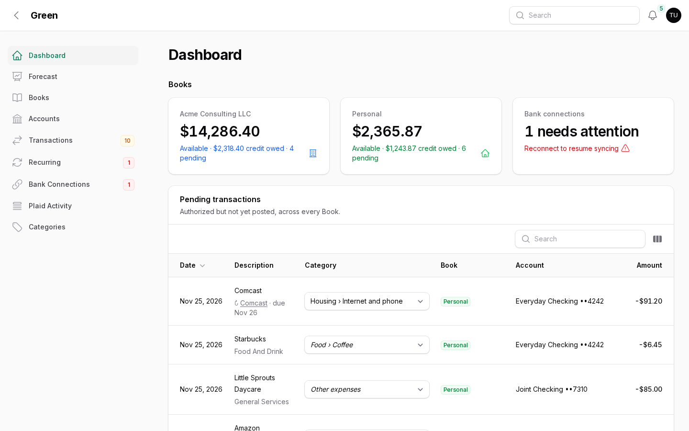
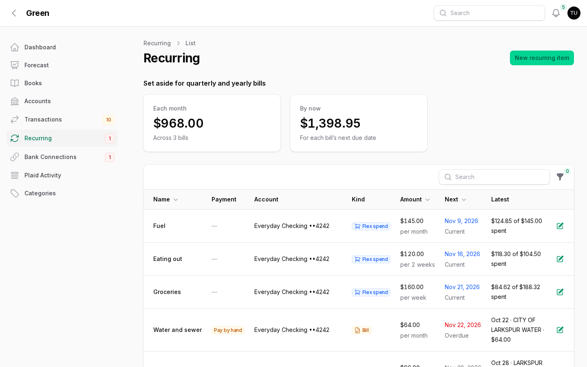
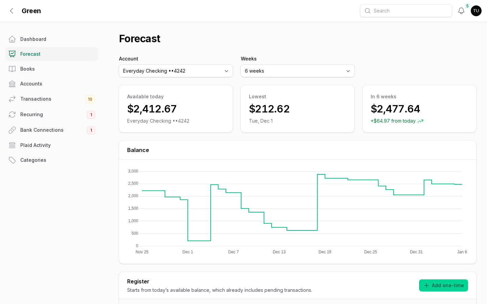

# Green

[](https://github.com/philmareu/green/actions/workflows/tests.yml)

**One place to see every Book you keep: business and personal, side by side.**

Green is a self-hosted, open-source finance viewer for independent contractors and anyone else who runs more than one set of books. Organize bank accounts into **Books** (your LLC, your household, a side project), connect them through [Plaid](https://plaid.com), and see every balance and transaction in a single interface. No switching workspaces.

It shows the two numbers your bank app makes you log in for:

- **Available balance.** What you can actually spend, after pending activity.
- **Pending transactions.** Card swipes and transfers that haven't posted yet, across every Book.

It also categorizes transactions, tracks recurring bills, budgets and income, and forecasts an account's balance a few weeks out.

You run Green yourself, with your own Plaid keys, and what it pulls from Plaid is stored only on your server. Green only reads from your banks: it can't move money. It isn't accounting software either. There are no invoices, no ledger and no manual accounts, and every balance and transaction comes from Plaid. It's built for US banks: Plaid's US institutions are the default, and the Business starter categories follow IRS Schedule C.

Built with [Laravel](https://laravel.com) and [Filament](https://filamentphp.com).



| Book view | Transactions |
|---|---|
|  |  |

| Recurring | Forecast |
|---|---|
|  |  |

## Project status and support

Green is a personal project. I built it for my own books, I use it every day, and I maintain it alone in my spare time. What that means for you:

- **No warranty and no paid support.** Green is [MIT licensed](LICENSE) and comes as it is. You host it, you look after it, and you run it at your own risk.
- **It's a viewer, not advice.** Green shows what your banks report through Plaid. Its categories, budgets and forecast are worked out from that data, and none of it is financial or tax advice.
- **Bug reports are welcome** in [issues](https://github.com/philmareu/green/issues). A reply may take a while.
- **Feature requests may be closed** when they don't fit what I need from Green. Forking is encouraged if you want to take it somewhere else.
- **Pull requests.** Small, focused bug fixes with tests are the most likely to be merged. Open an issue before you start anything larger. See [CONTRIBUTING.md](CONTRIBUTING.md).
- **Security reports come first.** Send them through GitHub's private vulnerability reporting, not a public issue. See [SECURITY.md](SECURITY.md).

## What it does

**Books and banks**

- **Books** group accounts however you think about your money. One bank login can feed several Books, so a business and a personal account at the same bank each live where they belong.
- **Dashboard** with cash available and credit owed per Book, plus every pending transaction in one table.
- **Plaid Link** connects your banks. Green never sees your bank password.
- **Hourly sync** with Plaid's `/transactions/sync`. A pending transaction is replaced when it posts, so nothing is counted twice.
- **Connection health.** A bank that needs you to sign in again is flagged, with a **Reconnect** button.
- **Live balance** on demand, straight from the bank.
- **Plaid Activity** lists every sync, Live balance, bank link and removal from the last 14 days, with Plaid's request IDs.

**Categories**

- **Category sets** per Book, with one level of subcategories and income, expense or transfer types. Start from a Business set based on IRS Schedule C or a Personal set, then edit freely. Books can share a set.
- **Suggestions.** Green suggests a category from Plaid's own category, and you choose which Plaid categories feed each of yours.
- **Payees.** Tell Green once that `slack` belongs in a category, and every transaction whose description contains it gets that category, now and after each sync.
- **Your picks are kept.** A category you choose yourself is never replaced, even when a pending transaction posts.

**Recurring bills, flex spends and income**

- **Bills and income** show, for each due date, the transaction that paid it. Green links a payment only when its description contains the payee you set, so a matching amount alone never counts, and it allows for small price changes. Anything you unlink stays unlinked.
- **Flex spends** such as groceries or gas are budgets per period, used up by spending in a category. They can roll over: what's left adds to the next period, and overspending takes from it.
- **Autopay.** Mark the bills that are paid automatically, and the ones you pay by hand stand out.
- **Set-asides.** Quarterly and yearly bills show what to put aside each month and how much should be aside by now, with a total on the Recurring list.
- **One-off changes.** Postpone, skip or mark paid a single due date. Later due dates stay on schedule.
- **Make recurring.** Turn any transaction into a recurring item in one click.

**Forecast**

- **Forecast** a checking or savings account 2 to 12 weeks out, starting from today's available balance, with a chart and a register of every expected bill, budget and income.
- **One-time items.** Add an expense or an expected payment and see what it does to the lowest point.

**Notifications**

- **Alerts** when a cash account goes negative, and when a flex spend reaches 80% of its budget or goes over.
- **Reminders** on bills and income, such as "3 days before: cancel Netflix", once or before every due date.
- **Your choice of channel.** Each user picks, per kind of notification, whether it shows in the app, goes out by email, both or neither. Email needs a mail provider ([Email alerts](#email-alerts)).

Light and dark mode, a responsive layout, and Filament's search, filters and column toggles throughout.

## Before you start

- **PHP 8.4 or 8.5** (8.4.1 or newer; the locked dependencies don't install on 8.3), with the [extensions Laravel requires](https://laravel.com/docs/13.x/deployment#server-requirements) plus `intl`, `zip` and `pdo_sqlite` (or `pdo_mysql`). Composer stops and names anything that's missing.
- **Composer 2** and **Git**.
- **A database.** SQLite is the default and needs no setup. MySQL works too.
- **A Plaid account.** [Sign-up](https://dashboard.plaid.com/signup) is free.

Node is not required.

**What Plaid access takes.** Plaid's Sandbox works as soon as you sign up: test banks, made-up data, no cost. That's enough to try everything in Green. Real banks are a separate step. You need Production access from Plaid, which is billed (new teams may qualify for a free trial with a limited number of bank connections), and Green has to be served over HTTPS. Plaid's onboarding for real banks is written for companies, so expect questions about your application and company. Read [Real banks](#real-banks) before you count on it.

## Try it with sample data

The fastest way to look around. No Plaid account needed.

```bash
git clone https://github.com/philmareu/green.git
cd green
composer setup
php artisan migrate --seed
php artisan serve
```

Open the URL the last command prints and sign in as `test@example.com` with the password `password`.

You get sample Books, accounts, transactions, categories, recurring items, a forecast and notifications. The demo's bank connections aren't real, so **Sync now** and **Live balance** fail on them. Everything else works.

The demo is for looking around on your own machine. Its login has a password anyone can look up, so it only loads where no real data lives: seeding refuses to run when `APP_ENV=production`, and in a database that already has another login. On a database that is already migrated, `php artisan db:seed` loads the same demo, and running it again rebuilds the demo from scratch.

When you want your own login in this copy, wipe the demo first. `green:install` won't add a real login next to the demo one:

```bash
php artisan migrate:fresh   # deletes everything in the database
php artisan green:install
```

## Install

This gets Green running on your own computer with your own login and no sample data. For a copy you leave running, or for real bank data, follow [Run it on a server](#run-it-on-a-server) instead.

```bash
git clone https://github.com/philmareu/green.git
cd green
composer setup
php artisan green:install
php artisan serve
```

- `composer setup` installs the dependencies, development tools included, and creates `.env`, an app key and an empty SQLite database at `database/database.sqlite`. The `.env` it writes is for development: `APP_ENV=local` and `APP_DEBUG=true`, where `.env.example` has the values for a server.
- `php artisan green:install` runs the migrations, then asks for the name, email and password (at least 8 characters) of your login. It warns that the Plaid keys aren't set yet. That's expected at this point.
- `php artisan serve` starts a development server. Open the URL it prints and sign in.

Then, in Green:

1. Open **Categories** and choose **Add starter sets** to get the Business and Personal category sets.
2. Open **Books** and create a Book for each business or household you track.
3. Add your Plaid keys ([Connect Plaid](#connect-plaid)), open a Book and choose **Link bank account**.

To add a login for someone else later, run `php artisan make:filament-user`. Each login is a separate user with their own Books, accounts and bank connections.

## Connect Plaid

1. Sign up at [dashboard.plaid.com](https://dashboard.plaid.com/signup) and copy your **client ID** and **Sandbox secret** from the [Keys page](https://dashboard.plaid.com/developers/keys).
2. Add them to `.env`:

   ```dotenv
   PLAID_CLIENT_ID=your-client-id
   PLAID_SECRET=your-sandbox-secret
   PLAID_ENV=sandbox
   ```

3. Open a Book, choose **Link bank account**, then **Continue to Plaid**. In the Sandbox, pick a test bank such as First Platypus Bank and sign in with username `user_good` and password `pass_good`. For realistic, changing data with pending transactions, use username `user_transactions_dynamic` with any password instead.

You can also link a Sandbox bank from the command line, without the browser flow:

```bash
php artisan plaid:sandbox-link 1
```

`1` is the Book's id, the number in its URL (`/books/1`). The command links First Platypus Bank as `user_transactions_dynamic` and runs a first sync.

Two settings apply at the moment a bank is linked, so set them first if the defaults don't suit you: `PLAID_DAYS_REQUESTED` is how many days of history Green asks Plaid for (90), and `PLAID_COUNTRY_CODES` is the list of countries whose banks Link offers (`US`).

### Real banks

Sandbox and Production are separate at Plaid. Moving to real banks takes these steps:

1. **Get Production access** in the Plaid dashboard, through a paid plan or a trial. Plaid asks for an application profile and company details, and some banks need a security questionnaire or take a few days longer to approve. [Plaid's OAuth guide](https://plaid.com/docs/link/oauth/) lists what it needs from you.
2. **Know the cost.** Plaid bills Transactions per connected bank, per month, for as long as the connection exists. **Live balance** calls `/accounts/balance/get`, which Plaid bills per request. Everything else Green does uses Transactions. New Plaid teams may qualify for a free Trial plan with a limited number of real bank connections. Check [Plaid's billing docs](https://plaid.com/docs/account/billing/) and [pricing](https://plaid.com/pricing/) for current terms.
3. **Serve Green over HTTPS.** Plaid only accepts HTTPS redirect URLs, and you are storing bank access tokens. See [Run it on a server](#run-it-on-a-server).
4. **Switch the keys** in `.env`:

   ```dotenv
   PLAID_ENV=production
   PLAID_SECRET=your-production-secret
   PLAID_REDIRECT_URI=https://green.example.com/plaid/oauth
   ```

5. **Register the redirect URL.** OAuth banks (Chase, Capital One, Wells Fargo and others) send you back to `PLAID_REDIRECT_URI` after you approve access. Add the same URL to the allowed redirect URIs in the [Plaid dashboard](https://dashboard.plaid.com/developers/api).

Banks you linked in the Sandbox don't work with production keys. Remove them under **Bank Connections** before you switch.

A connection is billed until it is removed at Plaid. **Remove** on the Bank Connections page does that, and deletes the bank's accounts and transactions from Green. Deleting Green's database or server does not, so remove your connections first if you ever shut Green down.

## Keeping data fresh

Green asks Plaid for updates. Plaid never calls Green.

- **Every hour**, the scheduler runs `php artisan plaid:sync`, which syncs balances and transactions for every connected bank.
- **The scheduler needs something to start it.** On a server that's a cron entry ([Run it on a server](#run-it-on-a-server)). On your own computer, leave `php artisan schedule:work` running in a second terminal. Without either, nothing syncs until you ask.
- **Any time**, press **Sync** on a Book or an account, or **Sync now** in the row menu of an account or bank connection.
- **When a bank needs you to sign in again**, Green flags it on the dashboard and under **Bank Connections**. Press **Reconnect**. The hourly sync skips that bank until you do.
- **Plaid Activity** lists every sync, Live balance, bank link and removal from the last 14 days: what started it, how long it took, what changed, any error, and Plaid's request IDs to match the log in Plaid's dashboard.

The scheduler also sends reminders every morning at 08:00 in `APP_TIMEZONE`, and deletes Plaid Activity entries older than 14 days.

## Run it on a server

`php artisan serve` is a development server. For a copy of Green you leave running, and for real bank data, use a real web server with HTTPS. Green is a standard Laravel application, so anything that hosts Laravel hosts Green.

You need PHP-FPM behind Nginx, Apache or Caddy, an HTTPS certificate, and cron. The server doesn't have to be reachable from the internet. Green only makes outgoing calls to Plaid, it has no webhooks, and the return from an OAuth bank is a redirect in your own browser. A machine on your home network or VPN works, as long as your browser reaches it at an HTTPS address.

### 1. Pick the user

PHP-FPM runs as a user, often `www-data`. That user must be able to write to `storage/`, `bootstrap/cache/` and, with SQLite, to `database/` and the database file in it.

The setup with the fewest surprises is one user for everything: the same user owns Green's files, runs PHP-FPM, runs the commands below and owns the cron entry. Then a file one of them creates can always be written by the others. If PHP-FPM runs as `www-data` and you work as someone else, run the commands as `www-data`, for example:

```bash
sudo -u www-data php artisan optimize
```

### 2. Install the code

Clone Green where your web server will serve it from. The examples below use `/var/www/green`:

```bash
cd /var/www
git clone https://github.com/philmareu/green.git
cd green
composer install --no-dev --optimize-autoloader
cp .env.example .env
php artisan key:generate
```

`--no-dev` leaves out the testing and development packages.

### 3. Edit `.env`

```dotenv
APP_URL=https://green.example.com
APP_TIMEZONE=America/Chicago
PRIVACY_CONTACT_EMAIL=you@example.com
```

- `APP_ENV=production` and `APP_DEBUG=false` are already set. Leave them. Production makes two-factor sign-in required for every user, and debug mode shows the details of every error to whoever caused it.
- `APP_URL` is the address you open Green at, and the one Green uses in the links it emails. When it starts with `https://`, Green's session cookie is only ever sent over HTTPS.
- `APP_TIMEZONE` decides what "today" is for due dates, overdue bills, the forecast and the 08:00 reminders.
- `PRIVACY_CONTACT_EMAIL` is shown on Green's public privacy page at `/privacy`. Leave it empty to show no address.

Add your Plaid keys as described in [Connect Plaid](#connect-plaid).

SQLite needs no database settings. For MySQL, create an empty database and replace the `DB_CONNECTION=sqlite` line:

```dotenv
DB_CONNECTION=mysql
DB_HOST=127.0.0.1
DB_PORT=3306
DB_DATABASE=green
DB_USERNAME=green
DB_PASSWORD=your-password
```

`.env` now holds your app key and Plaid secret. Make it readable by its owner only:

```bash
chmod 600 .env
```

### 4. Create the database and your login

```bash
touch database/database.sqlite   # SQLite only
php artisan green:install
php artisan optimize
```

`php artisan green:install` runs the migrations and asks for the name, email and password of your login.

`php artisan optimize` caches the configuration, routes and views. From then on Green reads the cache, not `.env`, so **run `php artisan optimize` again after every change to `.env`**. The route cache is also what makes two-factor sign-in required, so it has to be built while `APP_ENV=production`.

### 5. Point the web server at `public/`

The document root is the `public/` directory inside Green, never the project root, which holds `.env`.

- **Nginx.** Use the [configuration in Laravel's deployment guide](https://laravel.com/docs/13.x/deployment#nginx). Change `server_name`, `root` and the PHP-FPM socket (the example names PHP 8.3's), then add your certificate.
- **Apache.** `public/.htaccess` is included. Enable `mod_rewrite` and allow overrides for the directory.
- **Caddy.** `root` at `public/` with `php_fastcgi` and `file_server`. Caddy gets the certificate for you.

If HTTPS ends at a separate reverse proxy, load balancer or tunnel that passes plain HTTP on to PHP, tell Green which proxy to believe. Set `TRUSTED_PROXIES` in `.env` to its address: `127.0.0.1` for a proxy on the same machine, or several addresses or CIDR ranges separated by commas. Without it, Green takes every request for plain HTTP from the proxy itself: pages link their CSS and JavaScript over `http://` and break, and everyone's failed sign-ins count against one address. `TRUSTED_PROXIES=*` believes whatever connects, which is only safe when nothing but the proxy can reach PHP.

### 6. Add the cron entry

In the crontab of the user from step 1:

```cron
* * * * * cd /var/www/green && php artisan schedule:run >> /dev/null 2>&1
```

This drives the hourly sync, the morning reminders and the daily cleanup. No queue worker is needed: `.env.example` sets `QUEUE_CONNECTION=sync`, so syncs and notifications run inside the scheduler. If you switch to the `database` or `redis` queue, also keep `php artisan queue:work` running.

### 7. Check it

Open your address and sign in. Green asks you to set up two-factor sign-in before it shows anything else. If it doesn't, `APP_ENV` wasn't `production` when you ran `php artisan optimize`.

`/up` returns 200 while Green is running, for an uptime monitor. When something goes wrong, look at the newest file in `storage/logs/` (one a day, kept for 14 days), and in **Plaid Activity** for trouble with a bank.

### Email alerts

Notifications in the app need no setup. For email, Green needs a mail provider. Until you set one, `MAIL_MAILER=log` writes emails to the log in `storage/logs/` instead of sending them.

With [Resend](https://resend.com):

```dotenv
MAIL_MAILER=resend
RESEND_API_KEY=your-api-key
MAIL_FROM_ADDRESS=green@your-domain.com
```

`MAIL_FROM_ADDRESS` must be on a domain you have verified in Resend. Any SMTP server works too: set `MAIL_MAILER=smtp` with `MAIL_HOST`, `MAIL_PORT`, `MAIL_USERNAME` and `MAIL_PASSWORD`.

Each user then turns email on for the alerts they want, under **Notifications** in the user menu. Emails name the account, bill or budget, and leave out balances and amounts.

## Update

There are no numbered releases yet. Updates land on the `main` branch, and the [commit history](https://github.com/philmareu/green/commits/main) shows what changed. [SECURITY.md](SECURITY.md) says how to be told about security fixes.

Back up first ([Back up and restore](#back-up-and-restore)), then:

```bash
cd /var/www/green
php artisan down
git pull
composer install --no-dev --optimize-autoloader
php artisan migrate --force
php artisan optimize
php artisan up
```

`php artisan down` shows a maintenance page while you work. `composer install` clears the caches, so always finish with `php artisan optimize`. If you run a queue worker, add `php artisan queue:restart`.

On a copy you installed with `composer setup`, `git pull`, `composer install` and `php artisan migrate` are enough.

## Back up and restore

Two things hold everything. Back them up together.

- **`.env`.** It holds `APP_KEY`, which encrypts your Plaid access tokens and two-factor secrets in the database. A database restored without its key can't read them: every bank has to be linked again and every user's two-factor sign-in reset.
- **The database.** With SQLite it's one file. Copy it safely while Green is running:

  ```bash
  sqlite3 database/database.sqlite ".backup '/path/to/backups/green-$(date +%F).sqlite'"
  ```

  With MySQL, use `mysqldump`:

  ```bash
  mysqldump --single-transaction green > /path/to/backups/green-$(date +%F).sql
  ```

Green keeps nothing else you need. `storage/` holds only logs and caches.

To restore, clone Green and run `composer install --no-dev --optimize-autoloader` as in [Run it on a server](#run-it-on-a-server). Copy your saved `.env` into place instead of creating a new one, and put the database back: the SQLite file at `database/database.sqlite`, or your MySQL dump imported into an empty database. Then run:

```bash
php artisan migrate --force
php artisan optimize
```

## Security

- **Encryption.** Plaid access tokens and two-factor secrets are encrypted in the database with your `APP_KEY`. Balances and transactions are stored as plain rows, so protect the database and its backups the way you would bank statements.
- **Rotating `APP_KEY`.** List the old key in `APP_PREVIOUS_KEYS` in `.env`, or every bank connection will need to be linked again.
- **No public registration.** Logins are created on the server with `php artisan make:filament-user`. Each user sees only their own Books, accounts and connections. There are no roles and no shared Books.
- **Two-factor sign-in.** With `APP_ENV=production`, every user sets up an authenticator app (1Password, Google Authenticator and the like) at their next sign-in and gets one-time recovery codes. Keep them somewhere safe. Elsewhere it's optional, under **Profile**. If someone loses both their device and their codes, clear their two-factor setup from the server so they can set it up again:

  ```bash
  php artisan tinker --execute 'App\Models\User::where("email", "you@example.com")->update(["app_authentication_secret" => null, "app_authentication_recovery_codes" => null]);'
  ```

- **Forgotten passwords.** Green sends no password reset emails. Users change their password under **Profile**. For one who can't sign in, set a new password from the server:

  ```bash
  php artisan tinker --execute 'App\Models\User::where("email", "you@example.com")->first()->update(["password" => "a-new-password"]);'
  ```

- **Privacy page.** `/privacy` is public and lists what Green stores and shares. It's linked from the sign-in page and from the page where you link a bank.
- **Development switches.** Never set `APP_DEBUG=true` or `APP_ENV=local` on a server other people can reach, and install with `--no-dev` there. A copy made with `composer setup` is a development copy: keep it on your own machine.
- **Search engines.** `robots.txt` asks them not to index any page of your copy.

Please report vulnerabilities privately. See [SECURITY.md](SECURITY.md).

## Development

```bash
git clone https://github.com/philmareu/green.git
cd green
composer setup
php artisan migrate --seed   # sample data; sign in as test@example.com / password
php artisan serve
```

```bash
composer test          # Pest test suite; every Plaid call is faked, no keys needed
vendor/bin/pint        # code style
```

`composer setup` writes a `.env` for development (`APP_ENV=local`, `APP_DEBUG=true`). There is no front-end build step. Composer publishes Filament's assets, and Green has no custom theme.

Where things live:

- `app/Services/Plaid/` talks to Plaid. `PlaidClient.php` is a thin HTTP client for the endpoints Green uses (Plaid has no official PHP SDK), and `SyncPlaidItem.php` is the cursor-based `/transactions/sync`, including pending to posted handling and safe retries.
- `app/Services/Categories/` holds the starter category lists and `CategorizeTransactions.php`, which decides each transaction's category.
- `app/Services/Recurring/` matches payments to bills and income (`MatchRecurringTransactions.php`) and projects balances (`ForecastBalance.php`). The schedule and budget rules are on the `Recurring` and `Occurrence` models.
- `app/Services/Notifications/` sends the negative balance alerts, budget alerts and reminders.
- `app/Filament/` is the interface: `Resources` for the Books, Accounts, Transactions, Recurring, Bank Connections, Plaid Activity and Categories screens, and `Pages` for the forecast (`Forecast.php`), linking a bank (`LinkBank.php`) and notification settings (`NotificationPreferences.php`).
- `app/Console/Commands/` and `routes/console.php` hold the commands and their schedule.
- `tests/Pest.php` has the Plaid response fixtures.

Amounts are stored exactly as Plaid sends them: positive means money left the account. Use `Transaction::signed_amount` for display.

`CLAUDE.md` is written for AI coding agents, and is also the most complete description of the domain rules. [CONTRIBUTING.md](CONTRIBUTING.md) covers what to do before you open a pull request.

## Roadmap

Things that may come, in no order and with no dates:

- Plaid webhooks for near-instant updates
- Warn when the same bank is linked twice
- Bulk categorizing
- Notes on transactions
- Reports: income and spending per Book, tax-time exports
- Manual accounts for banks Plaid doesn't support

[Project status and support](#project-status-and-support) says what to expect from requests outside this list.

## License

Green is open-source software licensed under the [MIT license](LICENSE).
