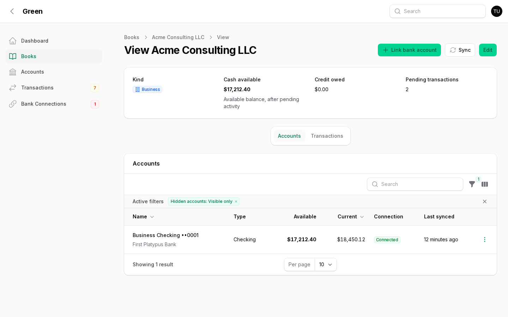
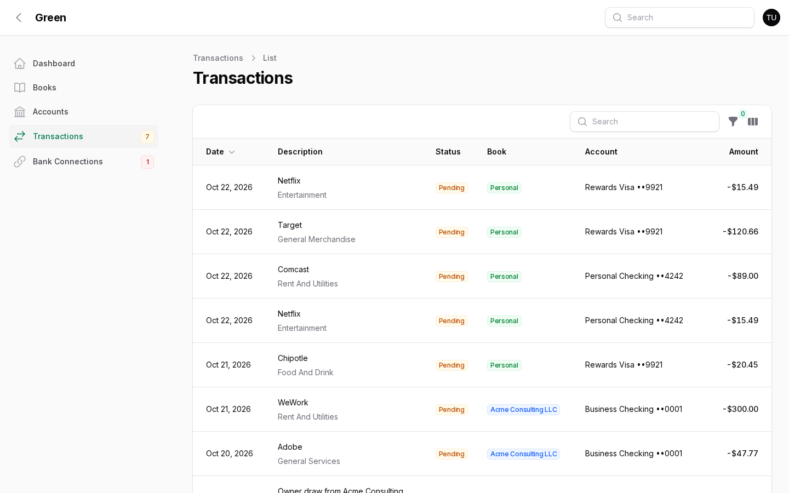

# Green

**One place to see every Book you keep: business and personal, side by side.**

Green is a self-hosted, open-source finance viewer for independent contractors and anyone else who runs more than one set of books. Organize bank accounts into **Books** (your LLC, your household, a side project), connect them through [Plaid](https://plaid.com), and see every balance and transaction in a single interface. No switching workspaces.

It shows the two numbers your bank app makes you log in for:

- **Available balance.** What you can actually spend, after pending activity.
- **Pending transactions.** Card swipes and transfers that haven't posted yet, across every Book.

Built with [Laravel](https://laravel.com) and [Filament](https://filamentphp.com).


| Book view | Transactions |
|---|---|
|  |  |

## Features

- **Books** group accounts however you think about your money. A single bank login can feed several Books, so a business and a personal account at the same bank can live where they belong.
- **Plaid Link** to connect thousands of banks. Green never sees your bank password.
- **Incremental sync** with Plaid's `/transactions/sync`. Pending transactions are replaced cleanly when they post, so nothing is counted twice.
- **Dashboard** with cash available and credit owed per Book, plus every pending transaction in one table.
- **Connection health.** Banks that need you to sign in again are flagged, with a one-click reconnect.
- **Live balance** on demand, straight from the bank.
- Light and dark mode, responsive layout, and Filament's search, filters and column toggles throughout.

## Requirements

- PHP 8.3+ with `pdo_sqlite` (or MySQL / PostgreSQL), `intl`, `bcmath` and `zip`
- Composer 2
- A Plaid account. [Sandbox keys are free](https://dashboard.plaid.com/signup).

Node is not required to run Green.

## Install

```bash
git clone https://github.com/philmareu/green.git
cd green
composer setup            # install dependencies, create .env, app key and SQLite database
php artisan green:install # run migrations and create your login
```

Add your Plaid keys to `.env` (see below), then start the app:

```bash
php artisan serve
```

Open the URL it prints and sign in. Create a Book, then choose **Link bank account**.

### Try it without Plaid

Load sample Books, accounts and transactions:

```bash
php artisan db:seed --class=DemoSeeder   # sign in as test@example.com / password
```

## Connecting Plaid

1. Sign up at [dashboard.plaid.com](https://dashboard.plaid.com/signup) and copy your **client ID** and **Sandbox secret** from the Keys page of the dashboard.
2. Add them to `.env`:

   ```dotenv
   PLAID_CLIENT_ID=your-client-id
   PLAID_SECRET=your-sandbox-secret
   PLAID_ENV=sandbox
   ```

3. In the Sandbox, any test bank works with username `user_good` and password `pass_good`. For realistic, changing data with pending transactions, use username `user_transactions_dynamic` with password `pass_good`.

You can also link a Sandbox bank from the command line, without the browser flow:

```bash
php artisan plaid:sandbox-link 1   # 1 = the Book's id
```

### Going to production

Set `PLAID_ENV=production` and use your production secret. Two things change:

- **Serve Green over HTTPS.** Plaid requires it in production, and you are storing bank access tokens.
- **OAuth banks** (Chase, Capital One, Wells Fargo and others) send users back to a registered redirect URL. Set `PLAID_REDIRECT_URI=https://your-domain/plaid/oauth` and add the same URL to the allowed redirect URIs in the Plaid dashboard.

New Plaid teams can use a free Trial plan for a limited number of real bank connections. Check [Plaid's pricing](https://plaid.com/pricing/) for current limits. **Live balance** calls `/accounts/balance/get`, which Plaid bills per call in production. Everything else Green does uses Transactions.

## Keeping data fresh

`php artisan plaid:sync` queues a sync for every connected bank, and the scheduler runs it hourly. Run the scheduler in production with a cron entry:

```cron
* * * * * cd /path/to/green && php artisan schedule:run >> /dev/null 2>&1
```

Locally, `php artisan schedule:work` does the same in the foreground.

`.env.example` sets `QUEUE_CONNECTION=sync`, so syncs run immediately and no queue worker is needed. If you switch to the `database` or `redis` queue, also run `php artisan queue:work`.

You can always press **Sync now** on a Book, account or bank connection.

## Security

- Plaid access tokens are encrypted at rest with your `APP_KEY`. **Back up `.env`.** If you rotate `APP_KEY`, list the old key in `APP_PREVIOUS_KEYS` or every bank connection will need to be linked again.
- Green has no public registration. Create logins with `php artisan make:filament-user`.
- Each user only sees their own Books, accounts and connections.

Please report vulnerabilities privately; see [SECURITY.md](SECURITY.md).

## Development

```bash
composer test          # Pest test suite; every Plaid call is faked, no keys needed
vendor/bin/pint        # code style
```

The interesting code lives in a few places:

| Path | What it does |
|---|---|
| `app/Services/Plaid/PlaidClient.php` | Thin HTTP client for the Plaid endpoints Green uses. Plaid has no official PHP SDK. |
| `app/Services/Plaid/SyncPlaidItem.php` | Cursor-based `/transactions/sync`, including pending → posted handling and safe retries. |
| `app/Filament/Pages/LinkBank.php` | Plaid Link in the browser, including update mode and OAuth return. |
| `app/Filament/Resources` | Books, Accounts, Transactions and Bank connections screens. |

Amounts are stored exactly as Plaid sends them: positive means money left the account. Use `Transaction::signed_amount` for display.

## Roadmap

- Plaid webhooks for near-instant updates
- Warn when the same bank is linked twice
- Categories, rules and notes
- Reports: income and spending per Book, tax-time exports
- Manual accounts for banks Plaid doesn't support

Ideas and pull requests are welcome; see [CONTRIBUTING.md](CONTRIBUTING.md).

## License

Green is open-source software licensed under the [MIT license](LICENSE).
